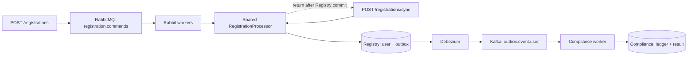

# Architecture

Async uses RabbitMQ; sync calls the same processor and transaction directly on its HTTP handler.

## Registry

- `RegistrationController` exposes both endpoints and validates input.
- `RegistrationRequestService` normalizes input and bounds outstanding HTTP work: `enqueue()` publishes
  async commands, while `registerDirectly()` calls the processor without RabbitMQ.
- `RegistrationCommandPublisher` sends async commands and waits for a broker confirmation.
- `RegistrationCommandListener` receives async commands from the Rabbit queue.
- `RegistrationProcessor` handles duplicate resolution and processing measurements.
- `RegistrationService` owns the user + outbox transaction. Repositories contain the SQL.

The user and outbox event commit together. Both the Rabbit listener and direct HTTP path call
`RegistrationProcessor`, which receives success only after the transactional service returns through
Spring's transaction proxy. Sync then returns its HTTP success; async has already received `202`.
Rabbit acknowledgement follows successful async processing.

Unique constraints protect registration id and email. If inserts race, the losing transaction rolls
back before duplicate resolution runs in a fresh transaction. An identical replay returns the stored
user and creates no second outbox event. Conflicting data is rejected.

## Compliance

Debezium routes committed outbox inserts to Kafka. Both endpoints create the same event contract and
use the same topic and `ComplianceService`. One transaction inserts the processed event id and the
result. Duplicate event ids have no additional effect. Kafka offsets advance after that transaction
completes. Neither HTTP route waits for downstream Compliance.

## Limits

| Setting | What it bounds |
|---|---|
| Intake maximum / admission wait | Admitted HTTP requests and waiting for a slot; async until confirmation, sync through commit |
| Rabbit consumer concurrency | Async registration messages being processed concurrently |
| Rabbit prefetch | Delivered, unfinished async messages per Rabbit worker |
| Hikari maximum pool size | Database connections shared by direct HTTP and Rabbit processing in Registry |
| Rabbit queue maximum length | Ready messages buffered before new publications are rejected |
| Kafka concurrency | Compliance workers, at most one active consumer per partition |

There is no additional registration execution semaphore. Sync holds its intake slot through its
direct transaction; Rabbit consumer settings do not cap sync concurrency. Virtual threads make
blocking waits cheaper; they do not add Rabbit workers or database connections. The
services have separate database pools. Tuning values live in `application.properties` and apply on restart.

## Recovery

- Async broker rejection, unroutable messages and uncertain confirmation outcomes return `503` with
  distinct reasons. Retry uncertain outcomes with the same key and body.
- Transient async Rabbit failures get three retries with backoff, then go to a dead-letter queue.
- Sync database failures propagate to HTTP without Rabbit retries. A lost response after commit is
  safely retried with the same key and body.
- Business conflicts are permanent: sync returns `409`; async goes to the dead-letter queue.
- Kafka failures get bounded retries and then a dead-letter topic. Invalid JSON skips retries.
- A crash between database commit and acknowledgement can cause redelivery. Database uniqueness
  and the Compliance event ledger prevent repeated effects.

Database commit and broker acknowledgement are not a distributed transaction. Delivery is at least
once, with idempotent database effects. Outbox rows are retained in this demo; production needs cleanup
and monitoring of the CDC replication slot's retained WAL.
