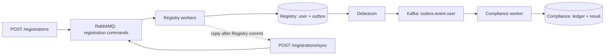

# Architecture

Both HTTP routes enter the same queue and execute the same registration transaction.

## Registry

- `RegistrationController` exposes both endpoints and validates input.
- `RegistrationIntakeService` normalizes input, creates a command and bounds outstanding HTTP work.
- `RegistrationCommandPublisher` sends commands: async waits for a broker confirmation; sync waits
  for a worker result using Spring AMQP request/reply.
- `RegistrationCommandListener` receives both kinds of command from the same queue.
- `RegistrationProcessor` handles duplicate resolution and processing measurements.
- `RegistrationService` owns the user + outbox transaction. Repositories contain the SQL.

The user and outbox event commit together. The worker returns success only after the transactional
service returns through Spring's transaction proxy. A sync caller receives that reply; an async
caller has already received `202`. Rabbit acknowledgement follows successful processing.

Unique constraints protect registration id and email. If inserts race, the losing transaction rolls
back before duplicate resolution runs in a fresh transaction. An identical replay returns the stored
user and creates no second outbox event. Conflicting data is rejected.

## Compliance

Debezium routes committed outbox inserts to Kafka. Both endpoints create the same event contract and
use the same topic and `ComplianceService`. One transaction inserts the processed event id and the
result. Duplicate event ids have no additional effect. Kafka offsets advance after that transaction
completes. Neither HTTP route waits for downstream Compliance.

## Limits

| Setting | What it bounds |
|---|---|
| Intake maximum / admission wait | Outstanding HTTP publication/reply waits and waiting for a slot |
| Rabbit consumer concurrency | Registration messages being processed concurrently |
| Rabbit prefetch | Delivered, unfinished messages per worker |
| Hikari maximum pool size | Database connections available to that service instance |
| Rabbit queue maximum length | Ready messages buffered before new publications are rejected |
| Sync reply timeout | HTTP wait; it does not cancel queued work |
| Kafka concurrency | Compliance workers, at most one active consumer per partition |

There is no additional registration execution semaphore. Sync holds its intake slot until reply or
timeout. Virtual threads make blocking waits cheaper; they do not add workers or connections. The
services have separate database pools. Tuning values live in `application.properties` and apply on restart.

## Recovery

- Broker rejection, unroutable messages and uncertain confirmation/reply outcomes return `503` with
  distinct reasons. Retry uncertain outcomes with the same key and body.
- Transient Rabbit failures get three retries with backoff, then go to a dead-letter queue.
- Business conflicts are permanent: sync returns `409`; async goes to the dead-letter queue.
- Kafka failures get bounded retries and then a dead-letter topic. Invalid JSON skips retries.
- A crash between database commit and acknowledgement can cause redelivery. Database uniqueness
  and the Compliance event ledger prevent repeated effects.

Database commit and broker acknowledgement are not a distributed transaction. Delivery is at least
once, with idempotent database effects. Outbox rows are retained in this demo; production needs cleanup
and monitoring of the CDC replication slot's retained WAL.
