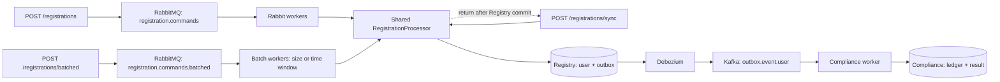

# Architecture

Async and batched use the same RabbitMQ broker. Sync processes directly on its HTTP handler.

`make up` builds and starts the complete stack in Docker, including Registry and Compliance. Kafka
topic initialization completes before Compliance starts. Connector registration follows Registry's
healthy startup, so its Flyway tables exist first. Prometheus scrapes the application containers by
service name; the API ports and Grafana remain available on localhost.

## Registry

- `RegistrationController` exposes all three endpoints and validates input.
- `RegistrationRequestService` normalizes input and bounds outstanding HTTP work: `enqueue()` publishes
  async commands, `enqueueBatched()` publishes to the batch queue, and `registerDirectly()` processes
  without RabbitMQ.
- `RegistrationCommandPublisher` sends queued commands and waits for a broker confirmation.
- `RegistrationCommandListener` receives async commands from the Rabbit queue.
- `RegistrationBatchListener` collects batch-queue deliveries and passes valid commands to the batch processor.
- `RegistrationProcessor` handles duplicate resolution and processing measurements.
- `RegistrationService` owns the user + outbox transaction. Repositories contain the SQL.

The user and outbox event commit together. Both the Rabbit listener and direct HTTP path call
`RegistrationProcessor`, which receives success only after the transactional service returns through
Spring's transaction proxy. Sync then returns its HTTP success; queued callers have already received `202`.
Rabbit acknowledgement follows successful processing. Batched uses its own queue on the same broker
so ordinary async processing remains available for comparison.

Batch workers collect up to `registry.batch.size` commands with `registry.batch.max-wait` as the
collection target (100 ms by default). Partial batches flush on a receive or gathering timeout.
Gathering time is checked between receive polls, so polling can add one extra receive wait; the target
excludes database waiting and processing. Workers bulk-read existing registration ids and batch-insert
new users and their outbox events in one transaction. Each new user still produces one outbox event;
identical replays produce none. Queue capacity limits waiting messages, not when a batch flushes.

Unique constraints protect registration id and email. If inserts race, the losing transaction rolls
back before duplicate resolution runs in a fresh transaction. An identical replay returns the stored
user and creates no second outbox event. Conflicting data is rejected.

## Compliance

Debezium routes committed outbox inserts to Kafka. All endpoints create the same event contract and
use the same topic and `ComplianceService`. One transaction inserts the processed event id and the
result. Duplicate event ids have no additional effect. Kafka offsets advance after that transaction
completes. No HTTP route waits for downstream Compliance. A larger Registry commit can make many
events visible to Debezium together; it does not change Compliance's per-event logic.

## Limits

| Setting | What it bounds |
|---|---|
| Intake maximum / admission wait | Admitted HTTP requests and waiting for a slot; queued until confirmation, sync through commit |
| Rabbit consumer concurrency | Workers for queued registration processing |
| Rabbit prefetch | Delivered, unfinished messages per Rabbit worker; not the DB batch size |
| Batch size / wait target | Commands grouped into a DB transaction / collection target before processing |
| Hikari maximum pool size | Database connections shared by direct HTTP and Rabbit processing in Registry |
| Rabbit queue maximum length | Ready messages buffered before new publications are rejected |
| Kafka concurrency | Compliance workers, at most one active consumer per partition |

Rabbit concurrency is per queue. With both queues active, each can have the configured worker count;
all workers and direct HTTP requests compete for the same Registry pool. Batch workers use one
connection per transaction, not one per registration in that batch.
The batch queue's effective prefetch is the larger of the configured prefetch and batch size. Thus
prefetch 8 / batch size 100 gives ordinary workers prefetch 8 and batch workers prefetch 100.

There is no additional registration execution semaphore. Sync holds its intake slot through its
direct transaction; Rabbit consumer settings do not cap sync concurrency. Virtual threads make
blocking waits cheaper; they do not add Rabbit workers or database connections. The
services have separate database pools. Tuning values live in `application.properties` and apply on restart.

## Recovery

- Queued broker rejection, unroutable messages and uncertain confirmation outcomes return `503` with
  distinct reasons. Retry uncertain outcomes with the same key and body.
- Transient async Rabbit failures get three retries with backoff, then go to a dead-letter queue.
- Sync database failures propagate to HTTP without Rabbit retries. A lost response after commit is
  safely retried with the same key and body.
- Business conflicts are permanent: sync returns `409`; queued processing sends conflicts to the dead-letter queue.
- A failed bulk write rolls its whole transaction back. Batch recovery isolates registrations so a
  conflicting command does not discard valid commands. Batch deliveries are acknowledged only after
  successful processing or confirmed forwarding into the original queue for recovery.
- Batch commands that need ordinary retry/dead-letter handling are forwarded into the original queue
  with publisher confirmation. A failed forwarding confirmation can cause batch redelivery, so
  already committed registrations must remain idempotent. Technical bulk failures use this same
  original-queue recovery path. Invalid batch payloads are isolated and forwarded individually.
- Kafka failures get bounded retries and then a dead-letter topic. Invalid JSON skips retries.
- A crash between database commit and acknowledgement can cause redelivery. Database uniqueness
  and the Compliance event ledger prevent repeated effects.

Database commit and broker acknowledgement are not a distributed transaction. Delivery is at least
once, with idempotent database effects. Outbox rows are retained in this demo; production needs cleanup
and monitoring of the CDC replication slot's retained WAL.
