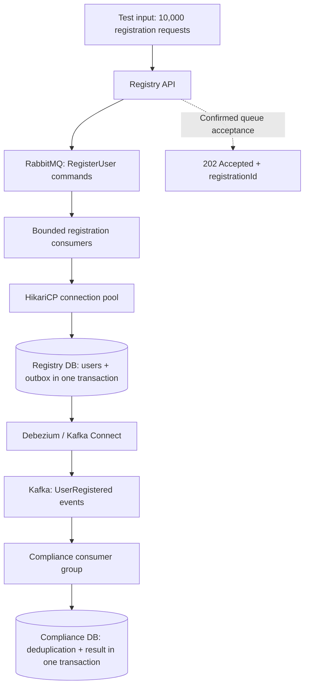
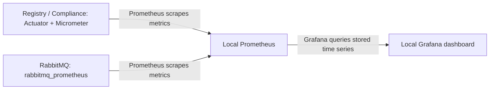

# User Registration Burst Processing — Implementation Plan

> Implementation update (2026-10-29): the original plan below is retained as the initial case design.
> The requested synchronous comparison is now implemented as `POST /registrations/sync`, sharing
> transaction/idempotency rules and bounded processing capacity with the Rabbit path. See
> [synchronous-registration.md](synchronous-registration.md) for its contract and measured runs, and
> [the README monitoring guide](../README.md#monitoring) for the expanded Grafana dashboard.

## 1. Objective

Build a small, explainable **Java 25 + Spring Boot** case that accepts a short burst of **10,000 registration requests** through an asynchronous **`202 Accepted` API**, processes them with bounded concurrency, and notifies a Compliance service through a transactional outbox, Debezium CDC, and Kafka.

The demonstration must explain how virtual threads, consumer concurrency, connection pooling, buffering, and idempotency work together. Use a conventional package-by-layer structure: controllers, services, repositories, and related supporting packages. Measure actual behavior rather than promising a throughput target in advance.

This is **10,000 requests in total**, submitted with configurable load-generator concurrency. It is not a claim of 10,000 requests per second or 10,000 simultaneous connections. The scope is backend processing and observability; the load generator is a test tool, not a client application to implement.

## 2. Architecture decision

**Decision: implement asynchronous registration with `202 Accepted`.** An accepted HTTP request and a completed user registration are separate milestones:



- RabbitMQ buffers registration commands before database work.
- Consumer concurrency limits the number of registration jobs executing simultaneously.
- HikariCP bounds the application's database connections and reuses them.
- One database transaction inserts the user and its outbox event.
- Debezium captures committed outbox inserts and publishes to Kafka.
- Compliance consumes the event independently and records a deterministic demo result.
- RabbitMQ smooths the burst; it does not increase the database's sustained write capacity.

**Documented alternative, not a second implementation:** If the API must confirm that a user already exists before returning, call the registration service directly, commit user + outbox, then return `201 Created`. CDC and Compliance remain asynchronous. Do not publish a command and immediately claim that the user was created.

## 3. Keep the scope small

### Build

- Two Spring Boot applications: `registry-service` and `compliance-service`.
- Registry API and Rabbit listeners in the same application, with separately understandable responsibilities.
- Java 25, Spring Boot 4.1.2, Maven Wrapper, Spring Web, Validation, Spring AMQP, Spring Kafka, Spring JDBC, HikariCP, Actuator, and Flyway as appropriate to each service.
- Java 25 consistently for the Maven compiler release/toolchain, local build, tests, application execution, and application container images. Verify the JDK before building; do not silently fall back to Java 21.
- Spring Boot virtual-thread support enabled by default, with an optional platform-thread comparison profile on the same Java 25 runtime.
- Conventional layer packages in both applications; no package-by-feature or hexagonal architecture required for this small case.
- Plain JDBC or `JdbcTemplate` for explicit transactions and predictable SQL; avoid adding JPA solely for this case.
- Docker Compose: one PostgreSQL server with separate service-owned databases, RabbitMQ with Management UI, Kafka in single-node KRaft mode, and Debezium Kafka Connect.
- A k6 load test and local Prometheus + Grafana for the visual demonstration. Replace the previously proposed custom HTML metrics page with one provisioned Grafana dashboard.
- Actuator + `micrometer-registry-prometheus` on both applications, and RabbitMQ's built-in `rabbitmq_prometheus` plugin.
- Meaningful integration tests and an English README with startup and presentation instructions.

Use Spring Boot 4.1.2 as the verified Java-25-compatible baseline. At implementation time, verify the compatibility of Debezium, Kafka, drivers, Maven plugins, and image versions using official documentation. Pin those versions; do not use floating `latest` image tags. No preview Java features, structured-concurrency API, or reactive rewrite are needed.

### Leave out of the first version

Kubernetes, service discovery, API gateways, Redis, distributed transactions, a separate worker microservice, a client application, frontend/user journeys, result polling, registration-status/lookup APIs, authentication, password registration, external compliance providers, and a second synchronous registration mode.

Single-node infrastructure is sufficient for this local case; it is not a high-availability deployment.

### Fully local operation

All applications, brokers, databases, CDC, monitoring, and load generation run locally. No cloud account, hosted Kafka, hosted Grafana, or external compliance API is needed. Initial downloads require internet access for the JDK, Maven dependencies, and pinned container images; after those are cached, the demonstration must work without internet access.

Provision the Grafana data source and dashboard from repository files. Use built-in Grafana panels and the Prometheus data source; do not require runtime plugin downloads, CDN assets, cloud credentials, or remote dashboard imports. Disable optional external reporting/update checks as needed for the offline demonstration. Application/demo metrics must remain local.

## 4. API and data contracts

### Registration intake

`POST /registrations`

- Require a UUID `Idempotency-Key`; use it as the `registrationId`.
- Accept only `fullName`, `email`, and `countryCode`.
- Validate and normalize fields before publishing.
- Put the registration ID, canonical payload fingerprint, payload, and submission timestamp in the command.
- Return `202 Accepted` with a non-empty JSON receipt containing the registration ID, only after a positive publisher confirmation and successful routing to the intended queue. No result URL or polling endpoint is required.
- The receipt means **the command was accepted**, not that a user was created or Compliance completed. Do not return an empty success response that leaves the contract implicit.
- Bound outstanding publications and confirmation waits independently of virtual-thread execution. If admission capacity is exhausted, reject promptly or after a short bounded wait with a controlled `503` response; do not build an unbounded in-memory waiting queue.
- Configure a finite publisher-confirmation timeout and release admission permits on every completion/failure path.
- Return `400` for malformed input. Return a controlled non-success response for confirmed broker refusal or an unavailable intake path.
- Distinguish a definite rejection from a confirmation timeout: a timeout can have an unknown outcome. Preserve server-side idempotency for repeated submissions with the same key; do not claim that a timed-out publication definitely failed to reach the queue.
- Do not claim an immediate `409` for a database conflict discovered later by a consumer.

### Backend-only verification

Verify completed registrations and Compliance results through integration tests, distinct database counts, correlated logs, and Grafana. Inspect permanent failures through the DLQ and logs. Do not add a user-facing lookup/status endpoint, polling workflow, notification channel, or durable request-status subsystem to this case.

### Registry data

- `users`: user ID, unique registration ID, payload fingerprint, normalized unique email, full name, country code, and creation timestamp.
- `outbox`: stable event ID, aggregate type, aggregate ID/user ID, event type, JSON payload, and timestamp compatible with the selected Debezium Outbox Event Router.
- Successful registration creates exactly one logical user and one logical `UserRegistered` outbox event per registration ID.
- Independent successful registrations must not contend on one global counter or application lock.

### Compliance data

- A unique processed-event record and a compliance result, committed in one local transaction.
- Use one deterministic example rule, explicitly presented as demo logic rather than real regulatory screening.
- Preserve the event ID, user ID, registration ID, and original submission timestamp for correlation and completion measurements.

## 5. Processing and failure rules

### Registry consumer

1. Read a command on a bounded Rabbit listener.
2. Enter the registration service's database transaction.
3. Handle idempotency, insert the user, and insert the outbox event atomically.
4. Return from the transactional service only after successful commit.
5. Acknowledge the Rabbit delivery after that commit.

Keep this path synchronous within each consumer's logical thread. Invoke a separate Spring-managed transactional service from the listener, so the service transaction commits before listener acknowledgement. Do not add `@Async`, detached `CompletableFuture` tasks, `parallelStream`, or an unbounded executor inside the listener. Listener concurrency already supplies the intended parallelism.

For duplicates:

- Same registration ID and same normalized payload: acknowledge without creating another user or outbox event.
- Same registration ID and a different payload: reject the conflicting delivery to the DLQ; preserve the original successful record.
- Another registration ID with an existing email: treat it as a permanent business conflict; create no additional user or success event.
- Enforce uniqueness in the database, including concurrent duplicate submissions. Handle uniqueness races at the transaction boundary; do not continue using a transaction already marked for rollback.

For failures:

- Roll back user and outbox together.
- Retry transient failures with finite attempts and backoff; avoid immediate infinite requeue loops.
- Route exhausted or permanent failures to a configured durable DLQ with correlation and a failure reason.
- A crash after DB commit but before ACK must result in harmless redelivery.
- Do not describe this as a globally atomic DB/Rabbit transaction or global exactly-once delivery.

Use durable queues, persistent commands, publisher confirms, and returned-message handling. Bound queue length and configure overflow to reject new publications rather than silently evict older accepted work. Provision enough capacity for the planned burst and test overload separately.

### CDC and Compliance

- Only Debezium publishes the normal outbox event stream to Kafka; do not substitute an application Kafka producer or a polling outbox publisher.
- Use the user ID as the Kafka key and a stable event ID for deduplication.
- Start with four event partitions and one Compliance consumer. Make consumer concurrency configurable.
- In the normal consumer-group model, active partition consumption is bounded by the partition count. More Compliance consumers do not directly speed up Registry database writes.
- Commit Compliance result + deduplication state before allowing offset advancement. Redelivery must not create another business effect.
- Keep transactions short. Do not hold a DB connection while waiting for Rabbit, Kafka, dashboard calls, or external APIs.
- For local restart demonstrations, retain broker data, connector offsets, and the PostgreSQL replication slot. Document outbox cleanup and retained WAL as operational considerations; do not build a cleanup subsystem for the MVP.

## 6. Virtual threads, concurrency, and pooling

### Runtime and execution model

- Enable `spring.threads.virtual.enabled=true` in the normal application profile.
- Set `spring.main.keep-alive=true` so a consumer application does not depend on daemon virtual threads to keep the JVM alive.
- Use Spring MVC with normal blocking request-handling code. A request can wait for a broker confirmation on a virtual thread without introducing a detached asynchronous workflow.
- Preserve Boot's auto-configured **Simple Rabbit listener container**. In Spring Boot 4.1.2, the virtual-thread setting also supplies its virtual-thread task executor. Keep consumer count explicitly configured; do not create an additional per-message executor.
- Four consumers mean four consumer tasks processing up to four messages concurrently in this design, even when those tasks run on virtual threads. It does not mean one unbounded task for every queued message.
- Keep JDBC and HikariCP. Virtual threads change the cost of waiting; they do not provide additional database connections or make SQL execution faster.
- Keep Kafka listener concurrency and partition limits explicit. Do not assume that every JVM or client-library thread becomes virtual when the Boot setting is enabled.
- Do not rely on `server.tomcat.threads.max` or executor thread-pool sizing properties as the admission limit in virtual-thread mode. Hikari pool limits and Rabbit consumer concurrency remain applicable.
- Verify actual HTTP handler and Simple Rabbit consumer execution with `Thread.isVirtual()` in integration tests or test-only diagnostics. Use a real embedded-server request for HTTP verification rather than assuming a mock controller test exercises the server executor.

The monitor-related virtual-thread pinning improvement was delivered in Java 24 and is included in Java 25. It does not remove normal lock contention or database resource limits. Use no special preview features to obtain this behavior.

### Consumer concurrency experiment

Use Java 25 with virtual threads **enabled** for experiments A/B/C. Use the same dataset and load-generator profile for each run. Keep Registry pool size at **4**, prefetch at **8 per consumer**, the intake admission limit unchanged, and one Registry application instance.

| Experiment | Registry consumers | Registry pool maximum | Question                                                       |
| ---------- | -----------------: | --------------------: | -------------------------------------------------------------- |
| A          |                  1 |                     4 | What is the sequential baseline?                               |
| B          |                  4 |                     4 | Does additional concurrency improve throughput?                |
| C          |                 16 |                     4 | How much time do excess workers spend waiting for connections? |

An optional pool-sizing extension can increase the pool while keeping 16 consumers to investigate database saturation. Do not assume that increasing both limits will improve performance.

These are demonstration settings, not recommended production sizes. Other Registry DB operations share this pool and may also wait. Account for that in the measurements.

Explain the distinctions explicitly:

- HTTP request handling governs admission and publishing; it is not the registration worker pool.
- Virtual threads are an execution mechanism, not an admission limit or a substitute for backpressure.
- Consumer concurrency is simultaneous message processing.
- Prefetch bounds delivered, unacknowledged work; it is not transaction concurrency.
- HikariCP limits database connections, not HTTP connections or total queued work.
- Across replicas, total possible database connections include every instance's pool plus other services and operational headroom.

### Optional threading-mode comparison

After the main case works, add experiment D: repeat B with **Java 25**, four Registry consumers, pool maximum four, and Registry virtual threads **disabled**. Keep the Compliance configuration, prefetch, admission limit, load-generator concurrency, data volume, and infrastructure resources identical.

Compare HTTP acceptance latency, registration throughput, drain time, DB connection waiting, platform-thread usage, and memory. Label this a **Registry application threading-mode comparison** because the Boot setting affects both supported HTTP and Rabbit execution. Do not present it as an isolated HTTP benchmark or switch Java versions between the runs.

The default implementation and required A/B/C experiments use virtual threads. The platform-thread comparison is optional presentation material, not a condition for completing the core case. A small or negligible improvement is a valid result.

## 7. Load test and measurements

Use a bounded-concurrency k6 `shared-iterations` scenario with **10,000 total iterations** and exactly one registration submission per iteration. Generate unique IDs and emails from a run ID and global iteration index. Report how long submission actually took. If the duration cap stops the run early, report an incomplete run rather than calling it a 10,000-request test.

Keep automatic submission retries out of the primary performance run so the counts remain clear. Run retry and duplicate tests separately.

Measure:

- Submitted requests, confirmed `202` responses, explicit failures, and unknown/timeout outcomes.
- HTTP acceptance p50/p95 latency.
- Registration and Compliance completion latency, separately.
- Registry committed registrations/second and total drain time.
- Rabbit ready and unacknowledged messages, plus DLQ depth.
- Hikari active, idle, pending/waiting connections, and acquisition timeouts.
- Java version, configured virtual-thread mode, verified HTTP/listener thread types, and platform-thread/memory observations when comparing threading modes.
- CDC health/lag and Kafka consumer lag, when available.
- Final distinct users, logical outbox events, and Compliance results for the run.

Keep load-generator and application CPU/resource limits visible in the report. A closed-loop bounded-concurrency run can reduce its send rate when responses slow down; do not label its result as a fixed arrival-rate benchmark.

For a successful unique-input run with no submission failures, expect 10,000 users, 10,000 logical outbox events, and 10,000 Compliance results after draining. Kafka record count can be higher because duplicate delivery is allowed.

Do not equate raw outbox table row count with CDC backlog: emitted rows can remain in the table. Do not invent a drain-time or p95 performance target before establishing a baseline on the actual machine.

## 8. Local Prometheus and Grafana demonstration

### Small monitoring architecture



Add two monitoring services to Docker Compose: **Prometheus** and **Grafana OSS**, using pinned compatible images. Grafana's supported OSS image repository is `grafana/grafana`; verify the selected tag at implementation time. Store monitoring data in local volumes. Expose Grafana on localhost, typically port 3000, and Prometheus on localhost, typically port 9090, with documented port overrides.

- Prometheus collects and stores time-series metrics.
- Grafana queries Prometheus and visualizes them.
- The applications expose `/actuator/prometheus`; RabbitMQ exposes its own Prometheus endpoint through the built-in plugin.
- Provision the local Prometheus data source and one compact dashboard automatically from version-controlled files. A reviewer should not need to assemble panels manually.
- Keep RabbitMQ Management UI available for message/queue inspection.
- Keep logs in the application/container console with registration/event correlation. No Loki, Tempo, OpenTelemetry collector, Alertmanager, or host monitoring agents are required for the first version.
- Do not build a second custom metrics website or a bespoke HTTP metrics aggregator.

### Dashboard panels

Use one dashboard with a common time axis, readable units, and short descriptions explaining the measurement boundaries.

| Panel                  | Display                                                                          | What the demonstration explains                                    |
| ---------------------- | -------------------------------------------------------------------------------- | ------------------------------------------------------------------ |
| 1. Observed progress   | Confirmed intake responses, committed registrations, completed Compliance checks | Acceptance and completion occur at different stages.               |
| 2. Throughput          | Accepted requests/sec, committed registrations/sec, Compliance completions/sec   | Where processing slows and how stages catch up.                    |
| 3. Rabbit work         | Registration queue ready + unacknowledged messages, and DLQ depth                | Burst buffering, in-flight work, draining, and permanent failures. |
| 4. Database pool       | Registry Hikari active, pending/waiting, and maximum connections                 | Extra consumers can wait for the same bounded pool.                |
| 5. Latency             | HTTP `202` p95, registration completion p95, and Compliance completion p95       | A fast receipt is different from fast end-to-end processing.       |
| 6. Errors and recovery | Intake failures, registration failures/retries, and deduplicated redeliveries    | Controlled overload, retry behavior, and duplicate handling.       |

Show consumer concurrency, prefetch, pool maximum, Java 25, and configured/verified virtual-thread mode as compact dashboard context. If the optional threading-mode comparison is included, add a small diagnostics row for platform-thread usage and JVM memory.

### Metric correctness

- Use Micrometer and the built-in Hikari instrumentation rather than polling application HTTP APIs to reconstruct pool behavior.
- Enable only the timer histograms required for the latency panels. Choose buckets that cover the actual durations, including queue waiting for completion timers, and calculate p95 from histogram observations. Do not invent p95 from an average or average together per-instance percentiles.
- Measure registration and Compliance completion using the original submission timestamp and successful commit boundaries. A listener execution timer alone excludes queue waiting and is not an end-to-end timer.
- Registration queue charts must have the correct queue labels. Rabbit's default aggregate endpoint is not sufficient for a queue-specific chart; configure targeted detailed or per-object collection for the registration queue and DLQ.
- A ready count of zero is not proof of draining while unacknowledged messages remain. Unacknowledged count is not the same as actively executing consumer count because prefetch can include waiting deliveries.
- Hikari pending means waiting for a connection; it does not by itself prove database CPU saturation.
- Application counters are observed process counters, can reset on restart, and are not an authoritative business ledger. The final distinct DB counts validate the 10,000-request run. Unknown HTTP outcomes and duplicate submissions can also make intake and completion counters differ.
- Use bounded labels such as service, queue, outcome, and event type. Never use registration IDs, event IDs, emails, or thread IDs as Prometheus labels; use logs for individual-request correlation.
- Start with a local scrape interval in the 2-5 second range and a dashboard refresh around 5 seconds. Use suitable rate windows and document them. Keep collection settings identical across comparison runs and account for monitoring overhead.
- Short spikes can be missed between scrapes. Preserve k6 request measurements and end-of-run verification alongside Grafana graphs.
- Display unavailable or not-yet-observed series honestly; do not convert a stopped target or missing metric to a misleading zero.

### Kafka and CDC observability boundary

Add a Kafka consumer-group lag panel only when an explicit exporter or Admin-based collector measures committed group offsets against partition end offsets. This is an optional monitoring extension; do not add a larger monitoring stack solely for it in the MVP.

The native consumer `records-lag-max` metric is not a substitute: it describes current consumer-position lag and may disappear when Compliance is stopped. It must not be presented as committed group lag that continues to be observed during an outage. Until a correct source is configured, mark that panel unavailable and document the local Kafka CLI command used to inspect group lag.

Similarly, expose Debezium/CDC health or capture lag only from a verified source. Raw outbox row count is not CDC backlog. Progress and throughput panels already provide a useful first demonstration without these optional exporters.

### Presentation sequence

1. Show the `202` receipt first, then the same request reaching Registry and Compliance. Explain acceptance versus completion.
2. Run experiment A with one consumer: observe queued work and drain time.
3. Run B with four consumers: compare throughput and draining while the pool remains four.
4. Run C with sixteen consumers: inspect pool waiting and throughput; explain the measured behavior rather than assume that more workers are faster.
5. Stop Compliance during a run: observe its target becoming unavailable while Registry can continue; after restart, observe catch-up. Show growing Kafka group lag only if the separate measurement source has been configured.
6. Redeliver a command/event: show deduplication observations and unchanged business DB counts.
7. Demonstrate a permanent failure appearing in the DLQ.
8. Optionally compare B and D while holding Java 25 and resource limits constant. Use dashboard annotations or clearly recorded test time ranges to identify runs.

If real DB work is too fast for an obvious queue, increase submission intensity or briefly pause consumption. Any artificial delay must be opt-in, visibly labeled, and excluded from genuine database performance claims. A delay outside a transaction does not demonstrate DB pool contention. Do not expose destructive reset or arbitrary failure controls through the public API.

## 9. Implementation phases and acceptance gates

| Phase                      | Deliverable                                                                                                                                 | Acceptance gate                                                                                                                                                                                                               |
| -------------------------- | ------------------------------------------------------------------------------------------------------------------------------------------- | ----------------------------------------------------------------------------------------------------------------------------------------------------------------------------------------------------------------------------- |
| 1. Foundation              | Java 25 across build/test/runtime, Spring Boot 4.1.2, two layered apps, Maven Wrapper, pinned Compose infrastructure, Flyway, health checks | Applications build and run on Java 25; containers become healthy; package structure and startup/shutdown commands are documented.                                                                                             |
| 2. Reliable Registry       | Validated `202` intake and receipt, bounded publishing/consumers, virtual-thread verification, atomic user/outbox transaction               | Actual HTTP and Simple Rabbit handler threads are verified virtual; resource limits remain effective; single registration, rollback, duplicate and conflict behavior pass.                                                    |
| 3. Real CDC and Compliance | Debezium connector/SMT, event topic, idempotent Compliance consumer                                                                         | Committed outbox insert reaches Compliance; rolled-back inserts do not; repeated event causes one business effect.                                                                                                            |
| 4. Failure verification    | Finite retries, DLQ, commit/ACK and result/offset boundary tests                                                                            | Restart/redelivery preserves invariants. Temporary dependency interruption and recovery are demonstrated with persisted local state.                                                                                          |
| 5. Measurement and display | Micrometer instrumentation, local Prometheus/Grafana provisioning, load script, experiment report, optional threading-mode comparison       | Prometheus targets and provisioned panels are verified against real metrics; actual submission totals, acceptance/completion latencies and A/B/C results are recorded; optional D holds Java 25 and resource limits constant. |
| 6. Interview handoff       | README, architecture diagram, tradeoffs, demo script, measured results                                                                      | A reviewer can start the project and reproduce the demonstration from the documented commands.                                                                                                                                |

Use unit tests for actual decision logic and integration tests with PostgreSQL/RabbitMQ/Kafka where their semantics matter. Verify the real Debezium path in an end-to-end test or repeatable scripted smoke test. Do not replace database behavior with H2 or mock CDC in the only end-to-end verification.

If Docker is unavailable, complete what can be built and tested locally, identify the exact unrun integration checks, and never report them as passing.

## 10. Repository and layered package structure

```text
registration-case/
  pom.xml
  mvnw / mvnw.cmd / .mvn/
  registry-service/
    src/main/java/com/example/registry/
      RegistryApplication.java
      controllers/
      services/
      repositories/
      models/
      dtos/
      listeners/
      messaging/
      config/
      exceptions/
    src/main/resources/
      application.yml
      db/migration/
    src/test/java/com/example/registry/
  compliance-service/
    src/main/java/com/example/compliance/
      ComplianceApplication.java
      controllers/
      services/
      repositories/
      models/
      dtos/
      listeners/
      messaging/
      config/
      exceptions/
    src/main/resources/
      application.yml
      db/migration/
    src/test/java/com/example/compliance/
  infra/
    compose.yaml
    postgres-init/
    debezium/
    monitoring/
      prometheus.yml
      grafana/
        provisioning/
        dashboards/
      rabbitmq/
  load-tests/
  docs/
    architecture.md
    demo-script.md
    benchmark-results.md
  README.md
```

Package responsibilities:

| Package        | Responsibility                                                                                | Example Registry classes                                                     |
| -------------- | --------------------------------------------------------------------------------------------- | ---------------------------------------------------------------------------- |
| `controllers`  | Registration HTTP mapping, request validation, acceptance responses and HTTP error boundaries | `RegistrationController`                                                     |
| `services`     | Intake orchestration, business rules and transaction ownership                                | `RegistrationIntakeService`, `RegistrationService`                           |
| `repositories` | Plain JDBC persistence and queries                                                            | `UserRepository`, `OutboxRepository`                                         |
| `models`       | Ordinary business/persistence records or classes                                              | `User`, `OutboxEvent`                                                        |
| `dtos`         | HTTP request and response contracts                                                           | `RegistrationRequest`, `RegistrationAcceptedResponse`                        |
| `listeners`    | Thin broker-entry adapters calling services                                                   | `RegistrationCommandListener`                                                |
| `messaging`    | Command publishing and explicit broker message contracts                                      | `RegistrationCommandPublisher`, `RegisterUserCommand`, `UserRegisteredEvent` |
| `config`       | Broker configuration and application properties integration                                   | `RabbitConfig`                                                               |
| `exceptions`   | Explicit exceptions and HTTP error mapping                                                    | `ApiExceptionHandler`                                                        |

Use the same conventions in Compliance, adding only packages/classes that are actually needed. Do not create an HTTP controller merely to proxy metrics; Actuator supplies the metrics endpoint. A controller is for an actual application endpoint, not a requirement to route Kafka consumption through HTTP. Mirror relevant packages under `src/test/java`.

Dependency paths:

- HTTP intake: `controllers -> services -> messaging`.
- Registration processing: `listeners -> services -> repositories`.
- Compliance processing: `listeners -> services -> repositories`.
- The Registry transactional service coordinates both user and outbox repositories.

Keep controllers and listeners thin. Repositories contain SQL, not HTTP or broker orchestration. Keep services concrete unless an interface has a genuine implementation need; do not create an interface/implementation pair for every class. No JPA entity layer or HTML-template `views` package is required for this MVC REST application.

Keep the outbox schema and event contract explicit. Avoid a shared business-logic library or extra abstraction layers unless the implementation demonstrates a concrete need.

## 11. Completion checklist

- [ ] A repeatable local startup procedure works.
- [ ] Both applications compile, test, and run on Java 25, including their application images.
- [ ] Layered packages separate controllers, listeners, services, repositories, and message/HTTP contracts.
- [ ] Virtual threads are enabled by default and verified for actual HTTP and Simple Rabbit handler execution.
- [ ] Intake admission, Rabbit concurrency/prefetch, and Hikari limits remain bounded in virtual-thread mode.
- [ ] `202` returns a registration ID after confirmed command acceptance; completion is verified through backend tests, DB counts, logs, and metrics.
- [ ] No client application, result polling, or user-facing registration-status/lookup API has been added.
- [ ] Registry transaction, command idempotency, and database uniqueness races are tested.
- [ ] Real Debezium CDC publishes committed outbox inserts.
- [ ] Compliance deduplication and result persistence are atomic.
- [ ] ACK/offset boundary redelivery does not duplicate business effects.
- [ ] Retry limits, overflow behavior, and DLQ routing are demonstrated.
- [ ] The full 10,000-submission experiments have recorded totals, hardware context, latency boundaries, and drain times, or are explicitly marked unrun/incomplete.
- [ ] Local Prometheus scrapes both applications and queue-specific Rabbit metrics; Grafana's data source/dashboard are provisioned from the repository.
- [ ] Grafana panels are verified against actual series, units, histogram boundaries, counter resets, and induced scenarios; unavailable data is not shown as a misleading zero.
- [ ] The demonstration works locally with cached dependencies/images and requires no cloud connection or runtime dashboard/plugin downloads.
- [ ] The documentation distinguishes local durability, at-least-once delivery, idempotent effects, and production high availability.

## 12. Instruction for Codex

> Implement this plan in a dedicated `registration-case` directory. Read the entire plan first. Use Java 25, the specified layered package structure, Spring Boot 4.1.2, virtual threads enabled by default, and the asynchronous `202 Accepted` receipt contract. Preserve the small two-application backend scope, bounded resources, and synchronous listener-to-transactional-service processing. Do not implement client workflows, polling, or user-facing registration-status/lookup APIs. Use local Prometheus and provisioned Grafana for graphs instead of a custom metrics website; require no cloud services or runtime plugin downloads. Work through the phases in order, use official documentation to verify version-sensitive details, and run the checks appropriate to each phase before proceeding. Keep progress reports concise. Do not substitute a polling publisher for Debezium, add detached per-message asynchronous work, or claim unmeasured performance. Record the exact checks run, measured results, and any remaining environment limitations. The first milestone is the working Registry transaction and Rabbit consumer, not the dashboard.

## Primary references

- [RabbitMQ: acknowledgements and publisher confirms](https://www.rabbitmq.com/docs/confirms)
- [RabbitMQ: consumer prefetch](https://www.rabbitmq.com/docs/consumer-prefetch)
- [Spring AMQP: listener concurrency](https://docs.spring.io/spring-amqp/reference/amqp/listener-concurrency.html)
- [Spring AMQP: transaction coordination](https://docs.spring.io/spring-amqp/reference/amqp/transactions.html)
- [HikariCP: pool sizing](https://github.com/brettwooldridge/HikariCP/wiki/About-Pool-Sizing)
- [Debezium: Outbox Event Router](https://debezium.io/documentation/reference/stable/transformations/outbox-event-router.html)
- [Spring Kafka: message listener containers](https://docs.spring.io/spring-kafka/reference/kafka/receiving-messages/message-listener-container.html)
- [Spring Boot: metrics](https://docs.spring.io/spring-boot/reference/actuator/metrics.html)
- [Spring Boot: system requirements](https://docs.spring.io/spring-boot/system-requirements.html)
- [Spring Boot: virtual threads](https://docs.spring.io/spring-boot/reference/features/spring-application.html#features.spring-application.virtual-threads)
- [Spring Boot 4.1.2: Rabbit virtual-thread auto-configuration](https://github.com/spring-projects/spring-boot/blob/v4.1.2/module/spring-boot-amqp/src/main/java/org/springframework/boot/amqp/autoconfigure/RabbitAnnotationDrivenConfiguration.java#L60-L77)
- [Spring Boot: application properties](https://docs.spring.io/spring-boot/appendix/application-properties/)
- [Oracle: Java 25 virtual threads](https://docs.oracle.com/en/java/javase/25/core/virtual-threads.html)
- [Oracle: Java 24 monitor-related pinning improvement](https://docs.oracle.com/en/java/javase/24/migrate/significant-changes-jdk-24.html)
- [k6: shared iterations](https://grafana.com/docs/k6/latest/using-k6/scenarios/executors/shared-iterations/)
- [HTTP: 202 Accepted](https://www.rfc-editor.org/rfc/rfc9110.html#name-202-accepted)
- [RabbitMQ: monitoring with Prometheus and Grafana](https://www.rabbitmq.com/docs/prometheus)
- [Grafana: local Docker installation](https://grafana.com/docs/grafana/latest/setup-grafana/installation/docker/)
- [Prometheus: histograms and percentiles](https://prometheus.io/docs/practices/histograms/)
- [Kafka: consumer metric definitions](https://kafka.apache.org/41/operations/monitoring/)
